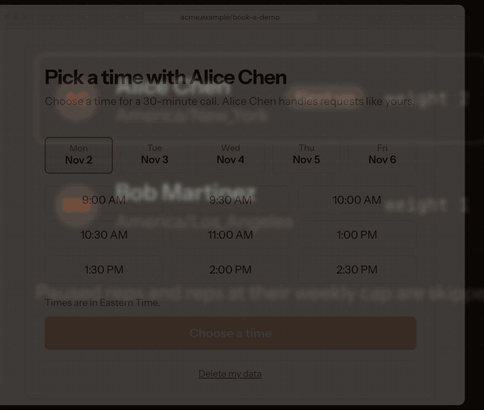
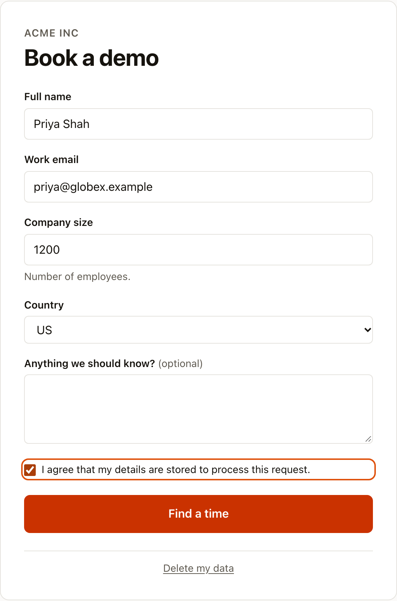
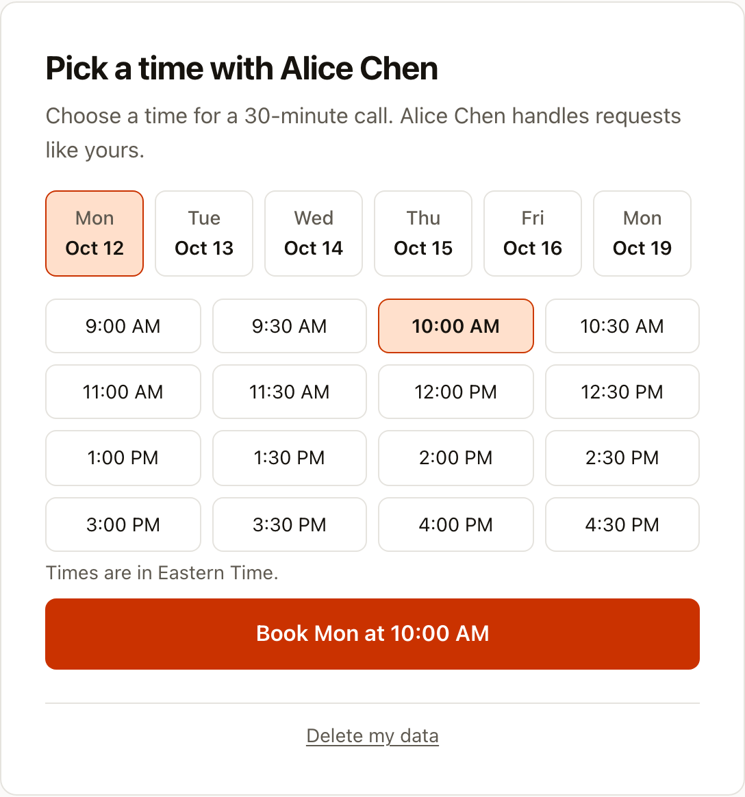
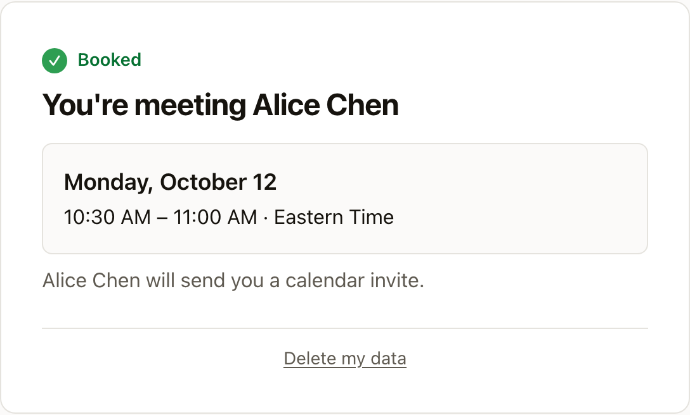
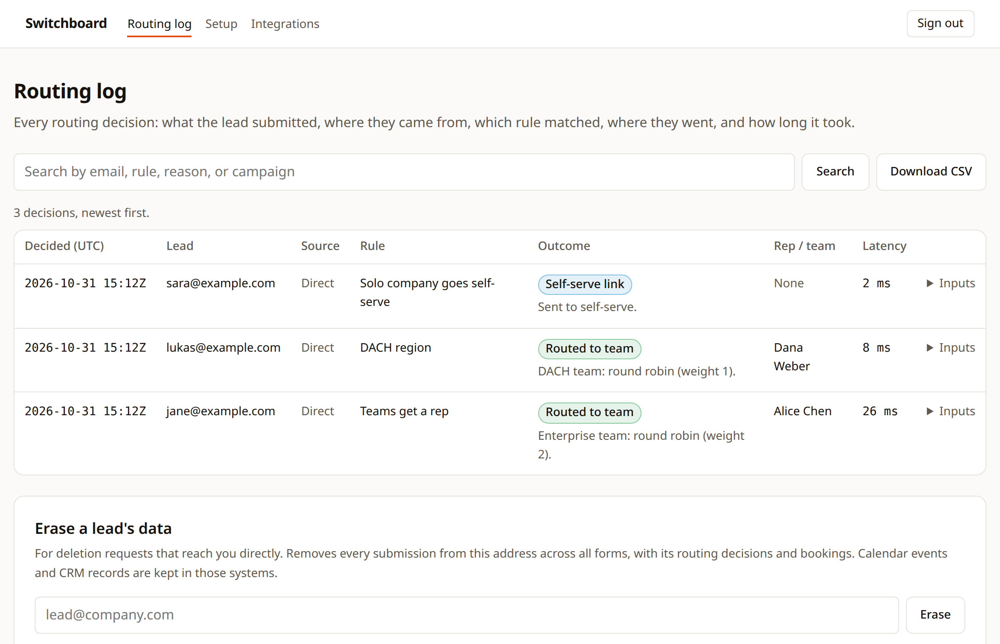

# Switchboard

**Route each inbound lead to the right rep, then let the lead book that rep's
calendar on the same page.**

Switchboard is an open-source, self-hosted alternative to inbound routing
tools like Chili Piper. A lead fills in your demo form. Your rules pick the rep
using the form answers and HubSpot. As soon as the lead submits, the form
turns into that rep's open times from their Google Calendar, and the lead
books without leaving the page. You keep the rules in a YAML file in git,
and you pay nothing per seat.

[](https://github.com/Preetish/switchboard/actions/workflows/ci.yml)
[](LICENSE)

**Live demo: [switchboard.preetish.me](https://switchboard.preetish.me)** — the demo workspace from the quick start below, running the latest release.

<p align="center">
  
</p>

<p align="center">
  
  
  
</p>

## Try it locally

```bash
git clone https://github.com/Preetish/switchboard && cd switchboard
docker compose up
```

Open http://localhost:3000/f/book-a-demo, enter a company size over 1, and
book a time (a size of 1 shows the self-serve message instead). To see the
decision in the routing log, sign in at
http://localhost:3000/login. Docker prints the admin password once when it
first starts:

```bash
docker compose logs app | grep "Admin login"
```

The demo comes with four fictional reps, three teams, and the rules in
[`examples/rules.example.yaml`](examples/rules.example.yaml).

## What happens when a lead submits

1. The lead fills in a hosted form at `/f/<slug>`, or the same form embedded
   on your site with two lines of HTML.
2. Your rules run in order against the answers and, if you connect HubSpot,
   the lead's CRM record. The first match decides. The demo rules send
   existing customers to their account owner, one-person companies to
   self-serve with a short explanation, companies in Germany, Austria, or
   Switzerland to the DACH team, and every larger company to the enterprise
   team. Within a team, reps take turns by weight, and you can cap a rep's
   meetings per week or pause them while they're away.
3. The lead sees open times from that rep's own Google Calendar and books
   one. Switchboard creates the event with a Google Meet link, logs the
   meeting in HubSpot, and emails the lead a confirmation. If the lead leaves
   without booking, the rep gets a Slack or email alert a few minutes later.

The routing log records every decision: what the lead entered, where they
came from (UTMs and ad click IDs such as `gclid` and `fbclid`), which rule
matched, who got the lead, and how long routing took. You can search it and
export it as CSV. When a lead submits or books inside the embed, your page
gets `switchboard_submitted` and `switchboard_booked` events in the GTM
`dataLayer`, so your GA4, Google Ads, and Meta tags count the conversion.

<p align="center">
  
</p>

## Set it up for your team

You describe your reps, teams, forms, and rules in one file and review
changes to it like code:

```yaml
# config/switchboard.yaml
org: { name: Acme, slug: acme }

reps:
  - { email: ana@acme.com, name: Ana Lopez, timezone: America/New_York }
  - { email: ben@acme.com, name: Ben Ito, timezone: America/Los_Angeles }

teams:
  - key: sales
    members: [{ rep: ana@acme.com, weight: 2 }, ben@acme.com]

forms:
  - slug: book-a-demo
    name: Book a demo
    fields:
      - { key: name, label: Full name, type: text, required: true }
      - { key: email, label: Work email, type: email, required: true }
      - { key: company_size, label: Company size, type: number, required: true }
    rules:
      rules:
        - name: Personal email goes self-serve
          when: { form.email: { freeEmail: true } }
          route: { action: self_serve_link }
      fallback: { team: sales, strategy: round_robin }
```

```bash
cp switchboard.example.yaml config/switchboard.yaml   # then edit it
npm run config:check -- config/switchboard.yaml       # validate it (works in CI)
docker compose up -d                                   # applies it on every start
```

If you make a mistake, Switchboard tells you where it is before any lead hits
it, for example:
`forms[0] (book-a-demo) rules rules[1] (DACH): team "dach" is not defined in teams`.

Add a `theme` to match your site: accent color, corner radius, font, light or
dark, and a borderless layout that blends into your page. The Setup page shows
a live preview of each form. See [Matching your site](docs/embed.md#matching-your-site).

Then open `/integrations`. You send each rep a link to connect their own
Google Calendar, and you connect HubSpot once for the whole org.

## Documentation

| Guide | Covers |
| --- | --- |
| [Configuration](docs/configuration.md) | `switchboard.yaml`, rule operators, how reps are picked |
| [Self-hosting](docs/self-hosting.md) | Deploying, environment variables, Google and HubSpot apps, HTTPS, upgrades |
| [Embedding](docs/embed.md) | Putting the form on your site, matching your brand, tracking campaigns |
| [Building your own form](docs/custom-form.md) | Using the API with your own markup |
| [HTTP API](docs/api.md) | The public and admin endpoints |
| [Architecture](docs/architecture.md) | How the code fits together, and how to add a calendar or CRM |
| [Design decisions](docs/decisions.md) | Why it works the way it does |

## Status and limits

This is v0.2. The full flow works, and unit, Postgres, and browser tests cover
it in CI, but the project is new. Today Switchboard supports Google Calendar
(Outlook isn't supported yet) and HubSpot (Salesforce isn't either). Each
instance serves one company with one admin login, and lead pages are in
English. The inline booking step offers 30-minute meetings. Rate limits live
in memory, so they apply per instance; if you run several, put a shared
limiter in front.

The [roadmap issue](https://github.com/Preetish/switchboard/issues/56) tracks
what's missing and what's next; comment there with what you need. The
[changelog](CHANGELOG.md) lists what changes in each release.

## Contributing

Bug reports, ideas, and pull requests are welcome. Start with
[CONTRIBUTING.md](CONTRIBUTING.md), and ask questions in
[Discussions](https://github.com/Preetish/switchboard/discussions). Please
report security issues privately as described in [SECURITY.md](SECURITY.md).

If Switchboard is useful to you, a star helps other people find it.

## License

[Apache-2.0](LICENSE)
